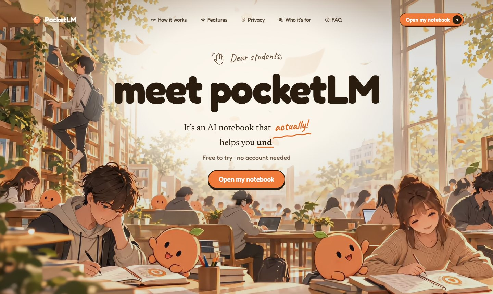
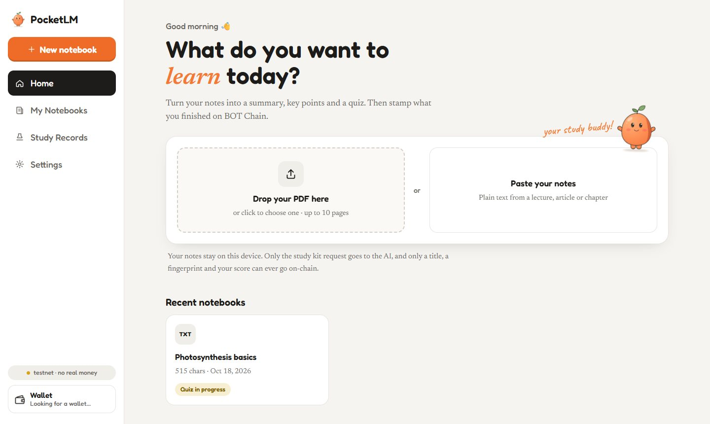
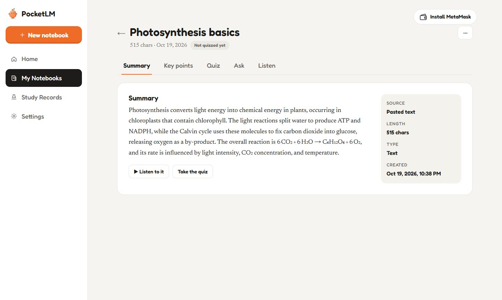
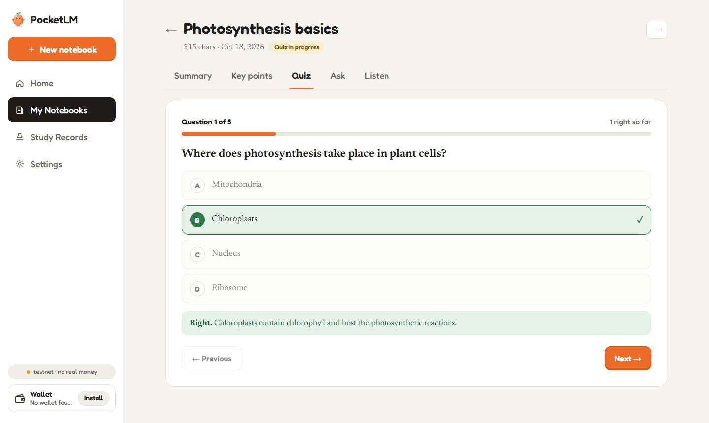
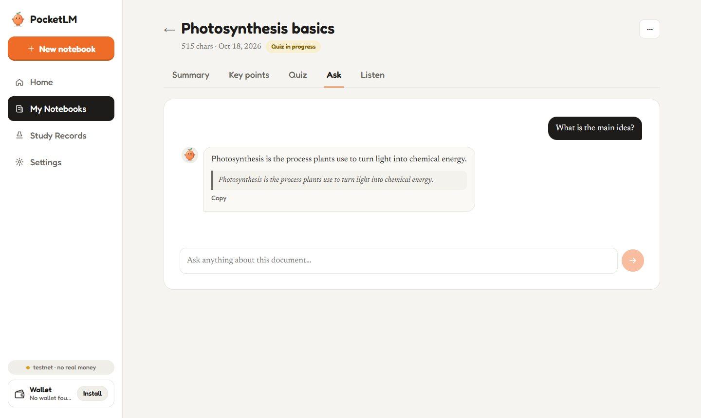
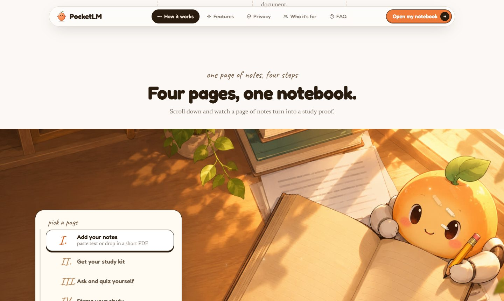

<div align="center">


# PocketLM

**An AI notebook that actually helps you learn, then proves it.**

Paste text or a short PDF and get a summary, 5 key points, a 5-question quiz and answers to your questions. Listen to the summary, finish the quiz, and stamp your study proof (title, a fingerprint of your notes and your score) on BOT Chain. Your notes never leave your browser except to be summarized, and they are never on-chain.

[**Live App**](https://pocketlm.my.id/) | [Contract (mainnet)](https://scan.botchain.ai/address/0xa0AD40C50001DEFcEe354Ec0316b99F78bD6c64f) | [Source](https://github.com/Devs-GMT/PocketLM) | [How it works](#how-it-works) | [Screens](#screenshots) | [Run it locally](#run-it-locally) | [Limits](#limits-said-plainly)


[](LICENSE)



</div>

## Screenshots

<table>
<tr>
<th width="50%">Home</th>
<th width="50%">Study kit summary</th>
</tr>
<tr>
<td></td>
<td></td>
</tr>
<tr>
<td>Drop a PDF or paste notes. Recent notebooks are saved only in your browser.</td>
<td>One request makes the summary, 5 key points and a quiz, with the source details beside it.</td>
</tr>
<tr>
<th>Quiz</th>
<th>Ask your notes</th>
</tr>
<tr>
<td></td>
<td></td>
</tr>
<tr>
<td>One question at a time. Right or wrong shows straight away, with the reason.</td>
<td>Answers come only from your document and quote the line they used.</td>
</tr>
</table>

<table>
<tr>
<th>Landing: how it works</th>
</tr>
<tr>
<td></td>
</tr>
<tr>
<td>Four pages, one notebook: add notes, get a study kit, ask and quiz yourself, then stamp your study on BOT Chain.</td>
</tr>
</table>

## How it works

1. Paste text or upload a PDF (up to 10 pages / ~20,000 characters). PDF text is read in your browser with pdf.js.
2. The text goes to our own API route (`/api/study`), which asks Groq for a summary, 5 key points and a 5-question quiz. `/api/ask` answers questions only from your document and quotes the line it used.
3. Listen uses the browser's built-in voice (sentence by sentence, with speed control). Nothing extra is sent anywhere.
4. The quiz is graded in your browser, one question at a time with the reason after each answer. Finish it and stamp `title + SHA-256 of the text + score` on BOT Chain from a confirmation dialog that shows exactly what goes on-chain.
5. `Study records` and `/app?study=ID` read the proof straight from the contract. No database, no accounts.

**Only the title, the document hash and the score are on-chain. The document text never is.**

## Screens

| Route | What it is |
|---|---|
| `/` | Landing page (hero video with a crossfade loop, how it works, features, FAQ, Pocket the guide) |
| `/app` | Home: drop a PDF or paste notes, recent notebooks |
| `/app/new` | Create a notebook (PDF or pasted text) |
| `/app/notebook?id=` | Summary, Key points, Quiz, Ask, Listen |
| `/app/notebooks` | My notebooks: search and delete |
| `/app/records` | Study records read from the contract, with stats and a time filter (`/shelf` redirects here) |
| `/app/settings` | Wallet, network and contract, delete local data |

Notebooks (your notes, the study kit and quiz progress) are saved **only in your browser** (localStorage, up to 30). Clearing browser data removes them; anything already stamped on-chain stays.

## Contract

`contracts/src/PocketLM.sol` (Solidity 0.8.24, no tokens, no payments, no admin).

| Network | Chain ID | Address |
|---|---|---|
| BOT Chain Testnet (development only) | 968 | `0x9e7ad905539f72c3Ae7B8f8637c19EEFBa8B61aA` ([scan.bohr.life](https://scan.bohr.life/address/0x9e7ad905539f72c3Ae7B8f8637c19EEFBa8B61aA)) |
| BOT Chain Mainnet | 677 | `0xa0AD40C50001DEFcEe354Ec0316b99F78bD6c64f` ([scan.botchain.ai](https://scan.botchain.ai/address/0xa0AD40C50001DEFcEe354Ec0316b99F78bD6c64f)) |

Study ids start at 1. Titles are limited to 80 bytes. `score <= total` and `total > 0` are enforced.

## Project layout

```
PocketLM/
  contracts/   Hardhat project: src/PocketLM.sol, test/, scripts/deploy.js, deployments/
  web/         Next.js app: pages and UI (app/, components/), browser logic and the
               Groq proxy (app/api/*, lib/), deployed to Vercel
```

## Run it locally

```bash
npm run install:all                               # installs web/ and contracts/
cp contracts/.env.example contracts/.env          # deployer key, testnet only
cp web/.env.local.example web/.env.local          # GROQ_API_KEY
npm run dev                                       # web app on http://localhost:3000
npm run test:contract                             # contract tests
npm run deploy:testnet                            # deploys to BOT Chain testnet, writes contracts/deployments/botTestnet.json
```

Secrets live only in `contracts/.env` and `web/.env.local` (both git-ignored).

## Deploy

The app is live at **https://pocketlm.my.id/** (BOT Chain mainnet). On Vercel, set the project's **Root Directory** to `web` and add these Environment Variables. The deployer key is never needed there.

| Variable | Value |
|---|---|
| `GROQ_API_KEY` | your Groq key (secret) |
| `GROQ_MODEL` | `openai/gpt-oss-120b` (optional) |
| `NEXT_PUBLIC_NETWORK` | optional, `mainnet` is the default; set `testnet` only for development |

The link preview image and page metadata use the production URL that Vercel provides. With a custom domain (the live app uses `pocketlm.my.id`), set `NEXT_PUBLIC_SITE_URL=https://pocketlm.my.id` so the preview links point to it.

## Mainnet (done by the owner, in Remix)

The mainnet contract is deployed at `0xa0AD40C50001DEFcEe354Ec0316b99F78bD6c64f`. To reproduce or redeploy:

1. Open `contracts/src/PocketLM.sol` in Remix. Compiler `0.8.24`, EVM version `paris`, optimizer on (200 runs). No constructor arguments.
2. Deploy with the mainnet wallet on BOT Chain (chain ID 677).
3. Nothing to set in Vercel: the address above and mainnet are the defaults. Set `NEXT_PUBLIC_CONTRACT_MAINNET=<address>` only if you deploy a new contract, and `NEXT_PUBLIC_MAINNET_RPC=<rpc url>` if the default RPC is wrong. Redeploy.
4. Replace `web/public/botchain-logo.svg` with the official BOT Chain logo (same file name).

## License

The code is released under the [MIT License](LICENSE). The PocketLM name and mascot artwork are not covered by it.

## Limits, said plainly

- **The score is self-reported.** The quiz is graded in the browser, so anyone can stamp any score. A stamp shows that a wallet logged a result at a given time, not that the person mastered the material.
- The rate limit is a simple per-IP counter in server memory. Fine for a demo; move it to Redis if traffic grows.

## Siapa yang menggunakan PocketLM?

### Pengguna utama

1. **Mahasiswa dan pelajar** (pengguna utama): mengunggah materi kuliah, memahami isinya lewat AI, mengerjakan kuis, dan mencatat progres belajar. Manfaat: belajar lebih cepat dan punya riwayat aktivitas belajar.
2. **Dosen atau mentor** (pihak yang memverifikasi): bisa memeriksa study record mahasiswa lewat blockchain explorer, misalnya untuk melihat bahwa mahasiswa mencatat hasil kuis tertentu pada waktu tertentu. Manfaat: memeriksa catatan tanpa bergantung sepenuhnya pada database PocketLM.
3. **Komunitas belajar atau penyelenggara program** (pihak yang menerima bukti): program belajar mandiri, komunitas bootcamp, atau penyelenggara challenge belajar yang ingin peserta mencatat progresnya secara transparan. Manfaat: catatan aktivitas belajar yang bisa diperiksa secara independen.

### Target pengguna tambahan

4. **Profesional yang melakukan upskilling**: karyawan yang mempelajari skill baru (AI, programming, cybersecurity, data analytics). Manfaat: mencatat aktivitas belajar mandiri sebagai pelengkap portofolio.
5. **Kreator kursus dan instruktur online**: memakai PocketLM sebagai alat bantu belajar untuk materi yang mereka buat. Integrasi langsung dengan kursus masih perlu dikembangkan.
6. **Perekrut dan tim HR**: bisa memeriksa riwayat belajar kandidat sebagai informasi tambahan tentang inisiatif pengembangan diri. Catatan PocketLM bukan bukti kompetensi atau penguasaan skill.
7. **Bootcamp dan penyelenggara pelatihan**: mengarahkan peserta mempelajari materi dan mencatat hasil kuis selama program. Verifikasi hasil yang jujur membutuhkan mekanisme tambahan.
8. **Developer dan komunitas Web3**: mempelajari dokumentasi blockchain, smart contract, protokol, atau SDK, lalu membagikan study record ke komunitas atau mentor.
9. **Perusahaan dan tim Learning & Development**: membantu karyawan memahami SOP, dokumentasi internal, atau materi pelatihan. Untuk dokumen rahasia dibutuhkan kontrol privasi dan akses tambahan.

## Roadmap

| Versi | Fitur dokumen |
|---|---|
| **MVP (V1)** | 1 dokumen per notebook, PDF atau paste teks |
| V1.1 | Bisa menambahkan beberapa dokumen ke notebook yang sama |
| V1.2 | AI menjawab pertanyaan berdasarkan seluruh dokumen |
| V2 | Ringkasan gabungan, kuis lintas dokumen, dan sitasi sumber dokumen |

Hanya MVP (V1) yang dikerjakan sekarang. Versi lain adalah rencana ke depan.

## Catatan penting

- Hanya **hash dokumen dan judul** yang masuk on-chain. Teks dokumen tidak pernah disimpan.
- Skor kuis dinilai di browser dan dicatat oleh pengguna sendiri (**self-reported**). Study record membuktikan bahwa sebuah wallet mencatat hasil pada waktu tertentu, bukan bahwa orang itu menguasai materinya.
